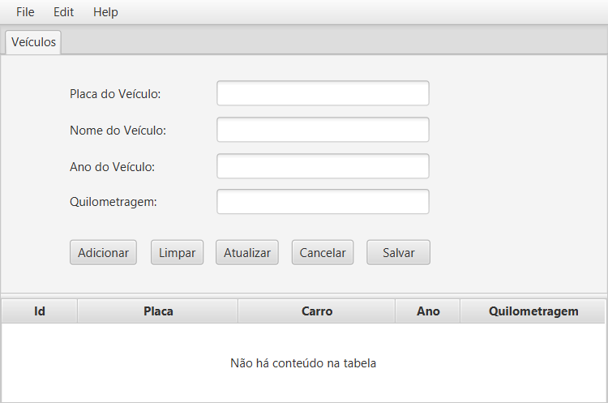
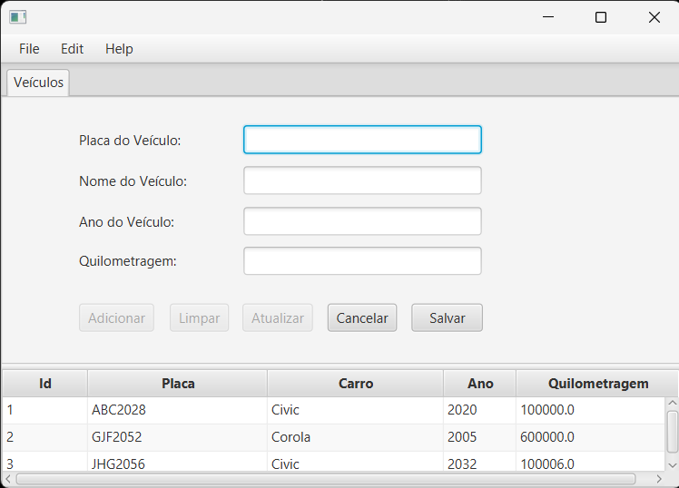
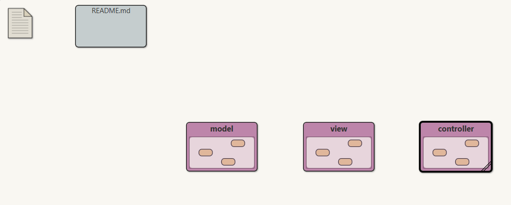
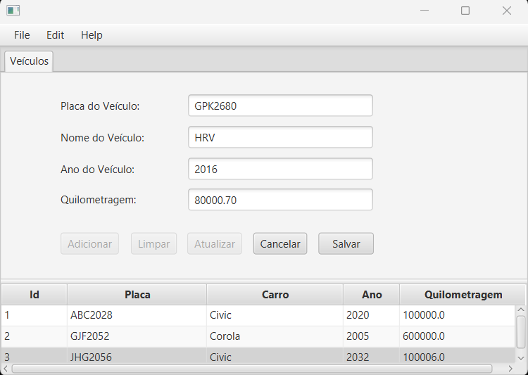
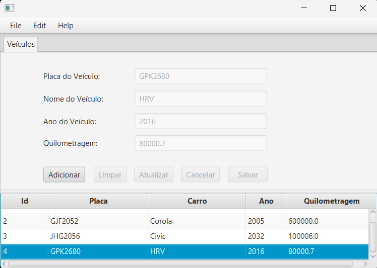
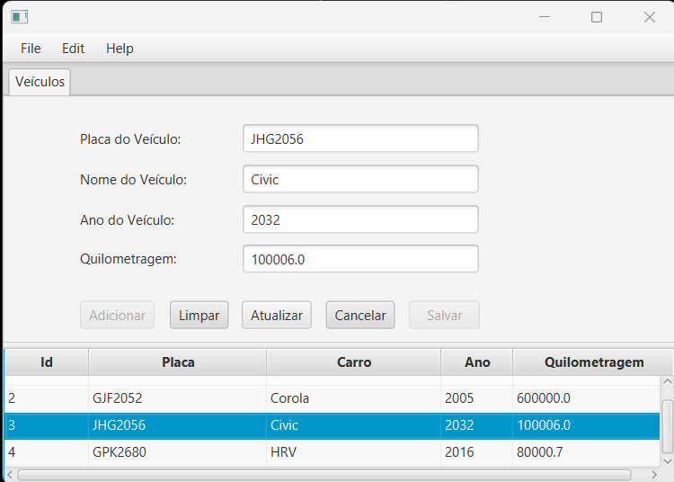
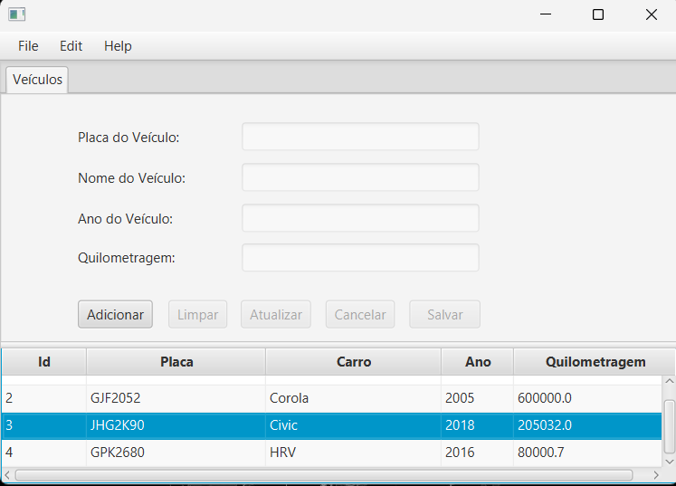

# Atividade-LAB 11(CRUD)

## Sistema de gerenciamento de veiculos

* Esta é uma aplicação que visa para gerenciar, cadastrar e atualizar dados de veículos, visto que é essencial saber o ano, modelo, quilometragem e placa;
* O projeto foi estruturado seguindo o padrão de arquitetura MVC.

## Pacote "model"
* Apresenta a classe Veiculo, VeiculoRepositorio, DataBase;
* É aqui onde demonstra para o sistema que todo veículo tem um ID, nome, placa, ano e quilometragem;
* Responsável por abrir a ponte de comunicação entre o seu código Java e o arquivo do banco de dados.

## Pacote "view"
* View é responsável exclusivamente por aquilo que o usuário vê e interage;
* O arquivo .fxml foi feito utilizando o SceneBuilder.

## Pacote "controller"
* Funciona como a ponte entre a interface do usuário "view" e o banco de dados "model";
* Apresenta apenas a classe "AppController", que realiza todas as operações de ligação necessarias;=.

## Como Funciona a aplicação?

* **Adicionar:** O usuário clica no botão "Adicionar" para destravar os campos e inserir os dados (Nome, Placa, Ano, Quilometragem). Em seguida, clica em "Salvar" para gravar no banco e listar na tabela.
* **Editar/Atualizar:** O usuário clica em um veículo já existente na tabela. Os dados preenchem os campos de texto. O usuário altera o que deseja diretamente nos campos e, ao finalizar, clica no botão "Atualizar" para registrar a modificação no banco de dados.
* **Cancelar/Limpar:** Aborta qualquer operação de edição ou criação em andamento, limpando os campos e bloqueando-os novamente por segurança.

## Funcionamento da Aplicação:

* Adicionar:

* Atualizar: 

