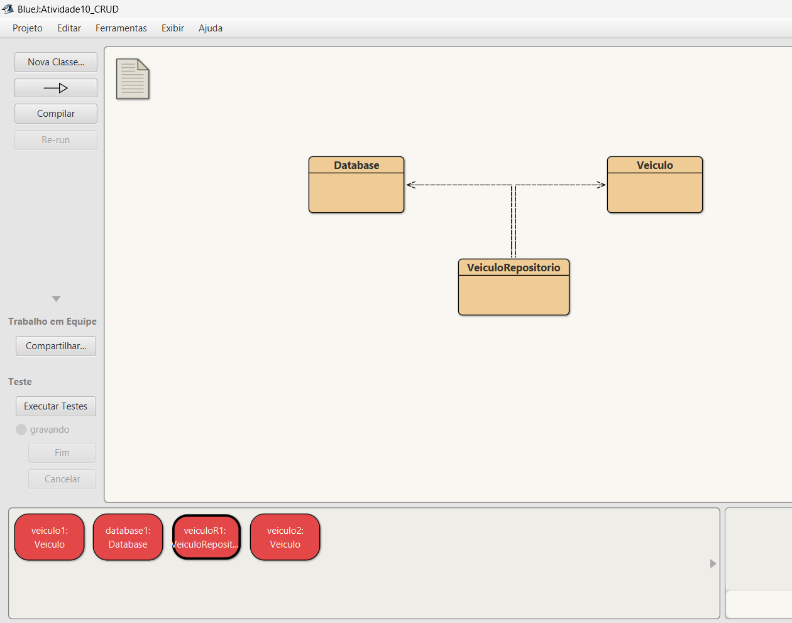
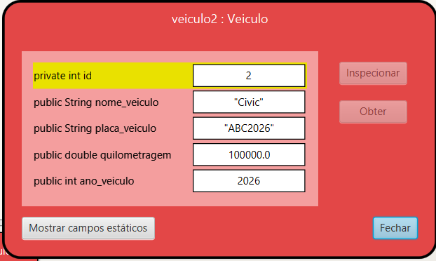
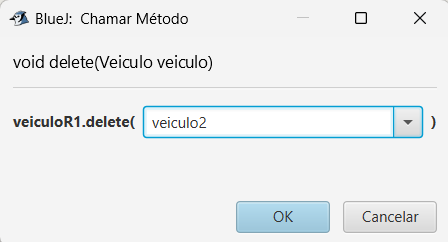
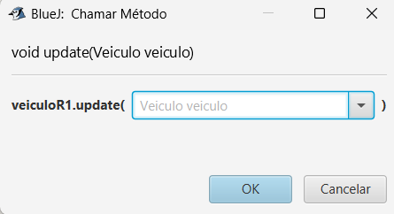
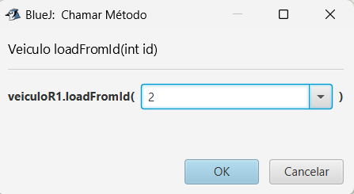
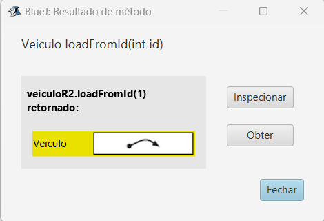

# Atividade POO: CRUD e ORM

Aluno: Felipe Silva Rego  
Matrícula: 202604043  

---

## Projeto: Data-base de Veículos

O projeto tem por objetivo construir um banco de dados para armazenamento e gerenciamento de frotas, registrando as seguintes informações:

* **Id do Veículo** (Identificador único)
* **Nome do Veículo**
* **Placa**
* **Ano do Veículo**
* **Quilometragem**

---

## Estrutura do Projeto

### 1. Classe Veiculo
Responsável pelo modelo da entidade. Possui métodos Getters e Setters para acessar e modificar os dados de forma segura, além de utilizar as anotações do framework **ORMLite** para o mapeamento objeto-relacional.

### 2. Classe Database
Responsável por gerenciar a conexão com o banco de dados SQLite. 
* **getConnection**: Método principal que verifica se já existe uma conexão aberta. Se não existir, inicializa e retorna uma nova conexão de forma segura.

### 3. Classe VeiculoRepositorio
Implementa o padrão arquitetural **Repository / DAO (Data Access Object)**, isolando a lógica de acesso aos dados e realizando as operações essenciais de CRUD (*Create, Read, Update, Delete*):

* **create**: Insere um novo veículo no banco de dados e o adiciona à lista local de cache loadedVeiculos.
* **update**: Atualiza no banco os dados de um veículo previamente cadastrado.
* **delete**: Remove o veículo do banco de dados e também o retira da lista de cache local.
* **loadFromId**: Realiza a busca de um único veículo no banco utilizando especificamente o seu ID.
* **loadAll**: Traz todos os veículos registrados no banco de dados e os armazena na lista loadedVeiculos.

## Evidências
### 1. Create

### 2. Delete

### 3. Update

### 4. Read

